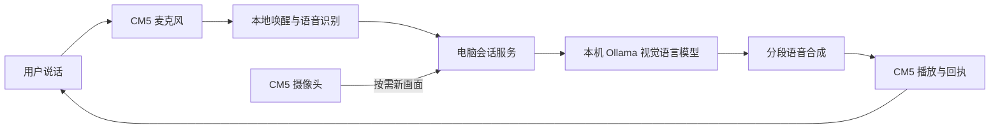

# AI Eyes Companion · 小瞳视觉语音交互原型

面向辅助视觉场景的中文语音与图片问答项目。CM5 采集声音和相机画面，电脑上的本地视觉语言模型回答，CM5 播放语音。程序支持连续追问、按需取新画面、分段播报、唤醒词打断和用户明确授权的简单记忆。

**这是电脑辅助的研究原型，不是自行训练的模型，也不是已完成验证的独立 AI 眼镜。** 它使用“语音识别 → 文字/图片模型 → 语音合成”的链路，不能声称原生全双工音视频。识物、细字、日期、复杂环境和自由插话仍有局限，不用于独立判断能否安全通行。

本仓库提供应用源码、配置示例、安装说明和软件测试。模型权重、密钥、私人对话、现场影像和系统运行环境须由使用者单独管理。软件检查不代表整机效果、准确率或长时间运行已通过验收。

## 组成与边界



| 部分 | 配置 | 说明 |
| --- | --- | --- |
| 模型 | `qwen3.5:4b`，非思考输出，4096 上下文 | Q4_K_M 为参考配置；同名远程标签可能更新，需记录实际模型摘要 |
| 电脑 | Windows + 本机 Ollama + 中文系统语音 | 内存与显存需求取决于模型、图像和上下文长度 |
| 设备 | CM5、Camera Module 3 Wide、ReSpeaker XVF3800 | 收音、唤醒、ASR、取图、播放在 CM5；主要视觉语言推理在电脑 |
| 语音识别 | sherpa-onnx、中文流式 Zipformer 14M | 权重另行准备；双声道中的选择通道可配置 |
| 相机 | rpicam / 可选 Picamera2 双输出 | 普通图 960×720、读字图 1920×1440；高像素不保证对焦或正确识别 |
| 大屏 | 可选事件适配器 | 大屏网站是独立项目，本包不包含其代码、Logo 和素材 |

程序有会话失效、迟到回答丢弃、停止播放、显式记忆增删和图片来源区分等机制。仍需用真实设备验证完整对话、回声、重复唤醒、画面时效和长时间稳定性。

## 先准备资源

详见 [模型和文件清单](docs/MODELS.md)。开发准备可以联网；离线运行要求先下载全部 Python 包、模型、系统中文音色和相机依赖。

电脑和 CM5 必须能互相传数据。断开互联网但保留有线局域网是一种部署方式；**这仍然需要电脑和本地连接**，不是“无需电脑/任何网络”的独立眼镜版本。USB 通道未在此包内适配。

## Windows 电脑端

在源码根目录使用 PowerShell；建议 Python 3.11：

```powershell
py -3.11 -m venv .venv
.\.venv\Scripts\python.exe -m pip install -r requirements-host.txt
```

安装官方 [Ollama](https://ollama.com/download/windows)，联网准备模型：

```powershell
ollama pull qwen3.5:4b
ollama show qwen3.5:4b
```

确保 Ollama 已在本机运行，且系统安装了 `Microsoft Huihui Desktop` 中文音色。这一音色由 Windows 提供，不随仓库分发。

```powershell
.\.venv\Scripts\python.exe run_host.py --ollama-url http://127.0.0.1:11434
```

服务会预加载模型和语音；健康接口 `http://127.0.0.1:4318/health` 的 `ready: true` 只表示电脑服务准备完成，**不表示设备已经连通或发声**。Ctrl+C 停止本服务；使用 `--ollama-url` 时不会停止你原来启动的 Ollama。

连接 CM5 时，将 `--bind` 改成电脑实际的本地网卡地址，例如下面的 `192.168.10.1` 仅是示例：

```powershell
.\start_host.ps1 --ollama-url http://127.0.0.1:11434 --bind 192.168.10.1
```

不要绑定到公网或配置公网端口转发。本机模型接口只接受环回地址；设备服务是供可信本地链路使用的 HTTP 原型，Bearer 令牌不能代替加密传输。程序不自动修改防火墙。

生成设备短提示（仅生成 WAV，不播放扬声器）：

```powershell
.\.venv\Scripts\python.exe tools/build_local_cues.py
```

文件写入 `assets/cues/`。将这个目录单独复制到 CM5 的同名目录。生成资源被 Git 忽略，不上传为仓库素材。

## CM5 端

使用 64 位 Raspberry Pi OS，在复制来的源码根目录执行：

```sh
python3 -m venv .venv
.venv/bin/python -m pip install --only-binary=:all: -r requirements-cm5.txt
mkdir -p assets .local
cp config/wake_config.example.json assets/wake_config.json
```

还需系统自带/安装的 `alsa-utils`（`arecord`、`aplay`、`amixer`）与 `rpicam-apps`。选择 Picamera2 时使用 Raspberry Pi OS 的 `python3-picamera2` 和 `/usr/bin/python3`，不要在语音环境中随意覆盖系统相机依赖。

按 [资源清单](docs/MODELS.md) 准备唤醒、ASR 权重和 `assets/cues/`。示例配置使用第二声道；其他麦克风、不同 XVF3800 固件必须核对通道，不能直接认定兼容。

电脑首次启动后会生成 `.local/device-token`。通过可信本地文件复制方式将该文件放到 CM5 的 `.local/device-token`，不要粘贴进公开聊天、Issue 或仓库。在 CM5 执行 `chmod 600 .local/device-token`。

先检查资源，不开启麦克风、相机或播放：

```sh
sh start_cm5.sh --check --assets ./assets
```

资源准备完成后才运行真实入口，以下地址必须替换为实际电脑地址：

```sh
sh start_cm5.sh --live --assets ./assets --host http://192.168.10.1:4318 --camera-backend picamera2
```

相机尚未配置 Picamera2 时，可明确选择 `--camera-backend rpicam`。声卡默认是 `Array`，实际设备不同时用 `--capture-device` 和 `--playback-device` 设置。发布版保留使用者系统音量，不写入原开发设备的音量值。

交互入口：

- 默认唤醒词“你好小瞳”；进入后可说普通问题，或“看看这个是什么”“读一下这个包装上的文字”。
- 播放时优先使用唤醒词打断；`--speech-barge-in` 是实验选项，不能当作已验证的自由插话。
- 终端 `/wake` 唤醒、`/stop` 停声、`/end` 待机、`/quit` 退出，Ctrl+C 同样退出。
- 默认不打印完整对话；需要现场诊断时显式开启 `--show-text`。
- 75℃芯片温度阈值是软件保护设置，不是佩戴温度标准。默认超限停采播；显式加 `--allow-system-shutdown` 才请求系统关机，权限不足可能失败。

## 软件检查与打包

```sh
python -m pip install -r requirements-host.txt
python -m unittest discover -s tests -v
python tools/build_release.py
```

测试中的模型和音频替身只用来检查程序逻辑，不是演示功能。打包脚本按明确的源码清单生成 `dist/ai-eyes-companion-source.zip`，不包含 `.local`、`.runtime`、虚拟环境、模型或现场素材，并生成文件摘要。

依赖来源和许可边界见 [THIRD_PARTY.md](THIRD_PARTY.md)。本仓库尚未由所有者选定开源许可证。
